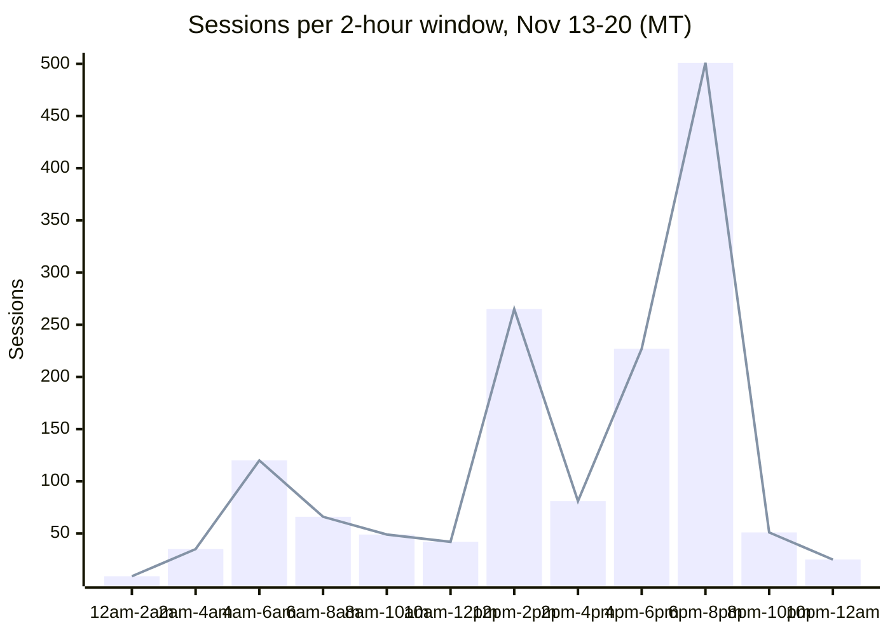
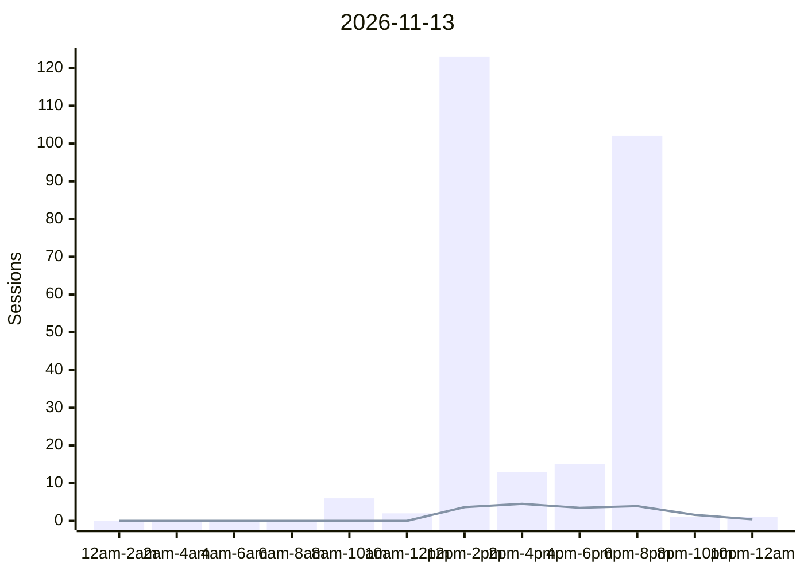
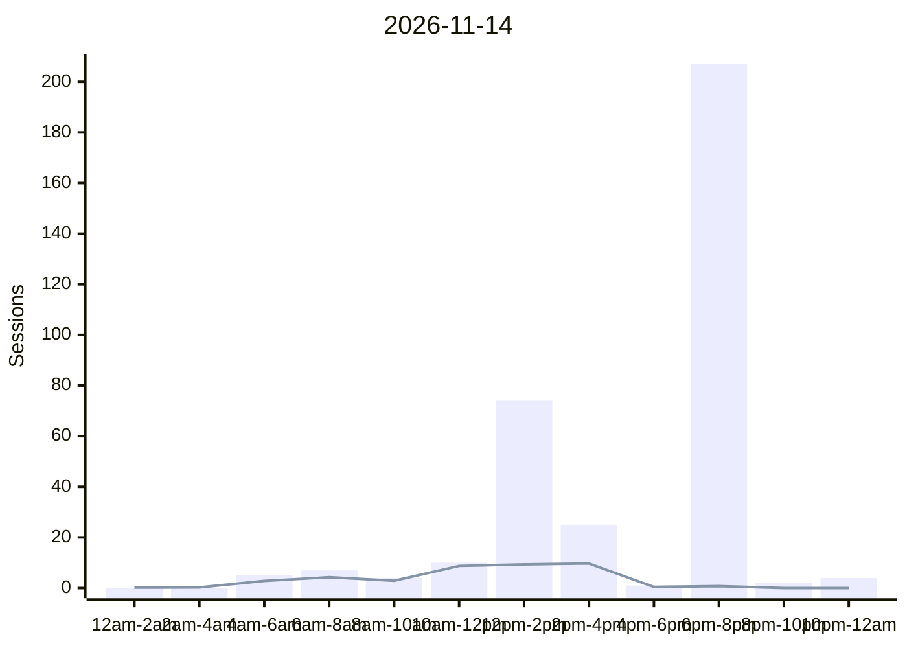
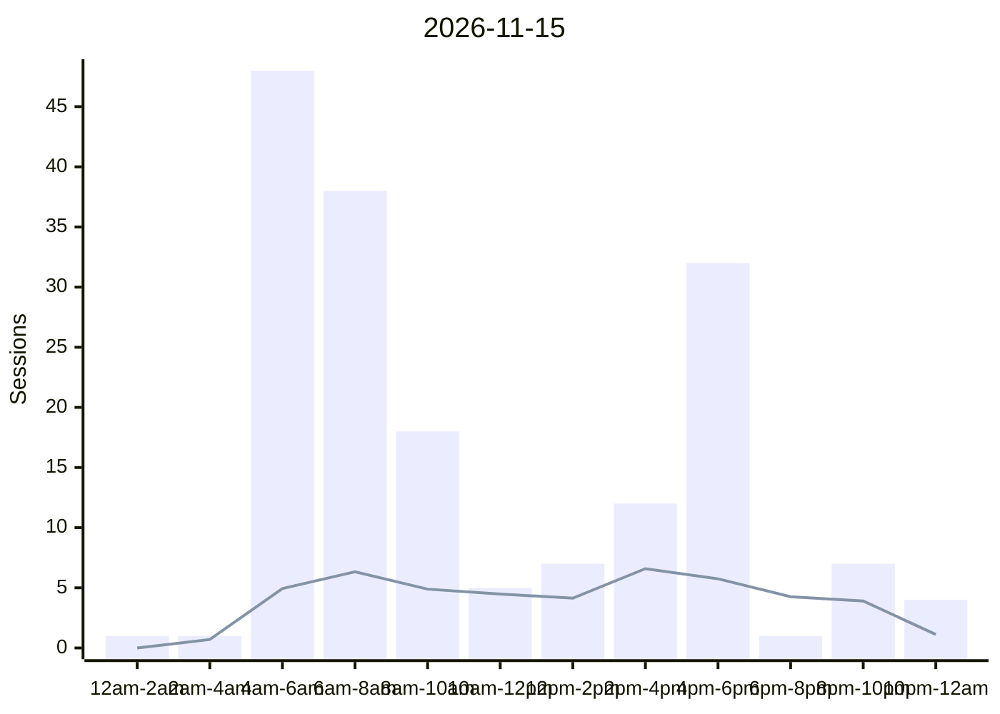
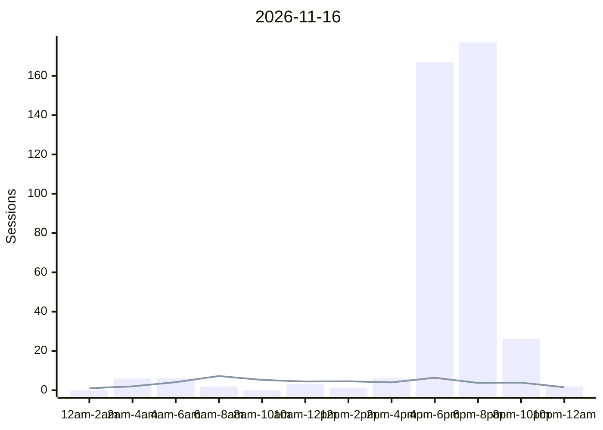
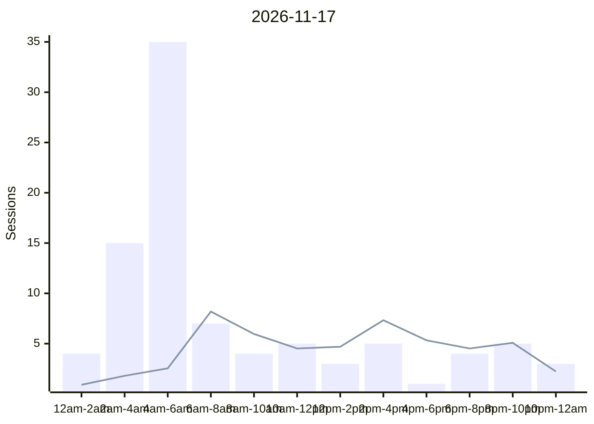
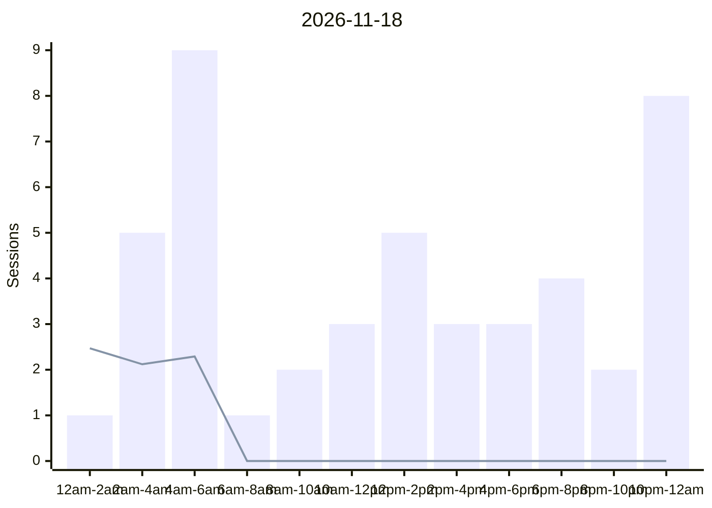
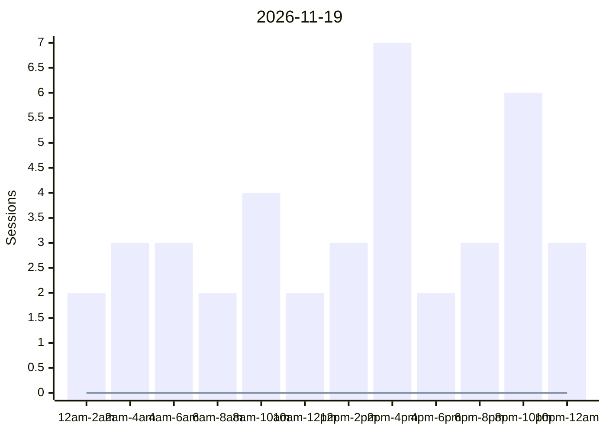
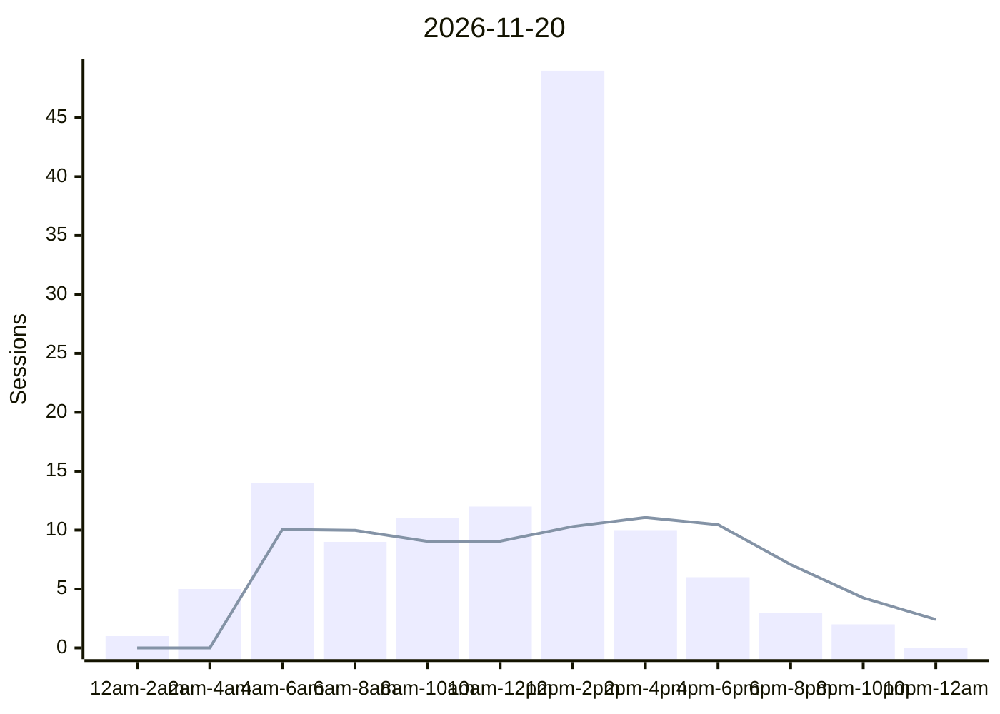

# Beema Health: Traffic by Time of Day (Nov 13 - Nov 20, 2026)

Source: GA4 property 546707320 (Beema Health) via the analytics MCP. Metric: **sessions**, grouped into 2-hour windows.  
**Time zone: America/Denver (Mountain)**, the GA4 property time zone. Nov 21 has no data yet, so the range ends Nov 20.

## Summary: largest-group window per day

| Date | Day | Sessions | Peak 2-hr window | Sessions in peak | Share of day | Meta spend | Peak spend window |
|---|---|---:|---|---:|---:|---:|---|
| 2026-11-13 | Fri | 263 | 12pm-2pm | 123 | 47% | $17.57 | 2pm-4pm |
| 2026-11-14 | Sat | 339 | 6pm-8pm | 207 | 61% | $39.42 | 2pm-4pm |
| 2026-11-15 | Sun | 174 | 4am-6am | 48 | 28% | $47.10 | 2pm-4pm |
| 2026-11-16 | Mon | 396 | 6pm-8pm | 177 | 45% | $48.08 | 6am-8am |
| 2026-11-17 | Tue | 91 | 4am-6am | 35 | 38% | $53.11 | 6am-8am |
| 2026-11-18 | Wed | 46 | 4am-6am | 9 | 20% | $6.88 | 12am-2am |
| 2026-11-19 | Thu | 40 | 2pm-4pm | 7 | 18% | $0.00 | none |
| 2026-11-20 | Fri | 122 | 12pm-2pm | 49 | 40% | $83.72 | 2pm-4pm |

**Total Meta spend Nov 13-20: $295.88** (ad account 'Beema', 1094621249825995, same America/Denver time zone as GA4). Nov 19 had $0 spend. Nov 21 so far: $0.42 (GA4 has no sessions for Nov 21 yet).
Spend per GA4 session over the period: $0.20. This is blended, since sessions include non-Meta traffic.

## Average / overall peak metrics

- **Average of the daily peak windows:** starts around **10:45am** (mean of each day's peak start hour).
- **Most frequent daily peak window:** 4am-6am (3 days), 12pm-2pm (2 days), 6pm-8pm (2 days), 2pm-4pm (1 days).
- **Peak window across all 8 days combined:** **6pm-8pm** with 501 of 1471 sessions (34%).
- **Meta spend does not explain the spikes.** Spend is spread fairly evenly through the day (roughly $1-6/hr), while sessions burst in single hours (Nov 13 12pm, Nov 14 7pm, Nov 16 5pm-8pm) with little spend in those hours. Nov 18-19 had almost no spend and almost no traffic. Those bursts likely came from another source (email, SMS, organic social, creator links).
- **Caution:** traffic is spiky. Single bursts (e.g. 118 sessions at 12pm on Nov 13, 141 at 7pm on Nov 14, 119 at 5pm on Nov 16) dominate their days and look like campaign or send-driven bursts rather than organic rhythm. Nov 17-19 are flat (1-6 sessions/hr), so the 'peak' there is weak.

## All days combined (sessions per 2-hr window)

```
  12am-2am | █                                        9
   2am-4am | ███                                      35
   4am-6am | ██████████                               120
   6am-8am | █████                                    66
  8am-10am | ████                                     49
 10am-12pm | ███                                      42
  12pm-2pm | █████████████████████                    265
   2pm-4pm | ██████                                   81
   4pm-6pm | ██████████████████                       227
   6pm-8pm | ████████████████████████████████████████ 501
  8pm-10pm | ████                                     51
 10pm-12am | ██                                       25
```

**Meta spend per 2-hour window (all days):**

```
  12am-2am | ████                                     $4.54
   2am-4am | ██████                                   $6.87
   4am-6am | █████████████████████████                $26.76
   6am-8am | █████████████████████████████████        $36.01
  8am-10am | ██████████████████████████               $28.06
 10am-12pm | █████████████████████████████            $31.25
  12pm-2pm | ██████████████████████████████████       $36.68
   2pm-4pm | ████████████████████████████████████████ $43.21
   4pm-6pm | █████████████████████████████            $31.84
   6pm-8pm | ██████████████████████                   $24.25
  8pm-10pm | █████████████████                        $18.68
 10pm-12am | ███████                                  $7.73
```



## Per-day charts

### 2026-11-13 (Friday) - 263 sessions, $17.57 Meta spend, peak 12pm-2pm

```
    window | sessions                                    n | spend
  12am-2am |                                             0 | $0.00
   2am-4am |                                             0 | $0.00
   4am-6am |                                             0 | $0.00
   6am-8am |                                             0 | $0.00
  8am-10am | ██                                          6 | $0.00
 10am-12pm | █                                           2 | $0.00
  12pm-2pm | ████████████████████████████████████████  123 | $3.64 <- peak
   2pm-4pm | ████                                       13 | $4.52
   4pm-6pm | █████                                      15 | $3.48
   6pm-8pm | █████████████████████████████████         102 | $3.92
  8pm-10pm |                                             1 | $1.59
 10pm-12am |                                             1 | $0.42
```


(Bars = sessions, line = Meta spend in USD.)

### 2026-11-14 (Saturday) - 339 sessions, $39.42 Meta spend, peak 6pm-8pm

```
    window | sessions                                    n | spend
  12am-2am |                                             0 | $0.16
   2am-4am |                                             0 | $0.27
   4am-6am | █                                           5 | $2.81
   6am-8am | █                                           7 | $4.27
  8am-10am | █                                           4 | $2.90
 10am-12pm | ██                                         10 | $8.74
  12pm-2pm | ██████████████                             74 | $9.35
   2pm-4pm | █████                                      25 | $9.70
   4pm-6pm |                                             1 | $0.45
   6pm-8pm | ████████████████████████████████████████  207 | $0.77 <- peak
  8pm-10pm |                                             2 | $0.00
 10pm-12am | █                                           4 | $0.00
```


(Bars = sessions, line = Meta spend in USD.)

### 2026-11-15 (Sunday) - 174 sessions, $47.10 Meta spend, peak 4am-6am

```
    window | sessions                                    n | spend
  12am-2am | █                                           1 | $0.00
   2am-4am | █                                           1 | $0.70
   4am-6am | ████████████████████████████████████████   48 | $4.94 <- peak
   6am-8am | ████████████████████████████████           38 | $6.33
  8am-10am | ███████████████                            18 | $4.89
 10am-12pm | ████                                        5 | $4.48
  12pm-2pm | ██████                                      7 | $4.14
   2pm-4pm | ██████████                                 12 | $6.59
   4pm-6pm | ███████████████████████████                32 | $5.75
   6pm-8pm | █                                           1 | $4.26
  8pm-10pm | ██████                                      7 | $3.90
 10pm-12am | ███                                         4 | $1.12
```


(Bars = sessions, line = Meta spend in USD.)

### 2026-11-16 (Monday) - 396 sessions, $48.08 Meta spend, peak 6pm-8pm

```
    window | sessions                                    n | spend
  12am-2am |                                             0 | $1.00
   2am-4am | █                                           6 | $1.98
   4am-6am | █                                           6 | $4.11
   6am-8am |                                             2 | $7.24
  8am-10am |                                             0 | $5.27
 10am-12pm | █                                           3 | $4.45
  12pm-2pm |                                             1 | $4.55
   2pm-4pm | █                                           6 | $4.00
   4pm-6pm | ██████████████████████████████████████    167 | $6.36
   6pm-8pm | ████████████████████████████████████████  177 | $3.71 <- peak
  8pm-10pm | ██████                                     26 | $3.86
 10pm-12am |                                             2 | $1.55
```


(Bars = sessions, line = Meta spend in USD.)

### 2026-11-17 (Tuesday) - 91 sessions, $53.11 Meta spend, peak 4am-6am

```
    window | sessions                                    n | spend
  12am-2am | █████                                       4 | $0.91
   2am-4am | █████████████████                          15 | $1.80
   4am-6am | ████████████████████████████████████████   35 | $2.55 <- peak
   6am-8am | ████████                                    7 | $8.19
  8am-10am | █████                                       4 | $5.96
 10am-12pm | ██████                                      5 | $4.52
  12pm-2pm | ███                                         3 | $4.69
   2pm-4pm | ██████                                      5 | $7.33
   4pm-6pm | █                                           1 | $5.33
   6pm-8pm | █████                                       4 | $4.52
  8pm-10pm | ██████                                      5 | $5.08
 10pm-12am | ███                                         3 | $2.23
```


(Bars = sessions, line = Meta spend in USD.)

### 2026-11-18 (Wednesday) - 46 sessions, $6.88 Meta spend, peak 4am-6am

```
    window | sessions                                    n | spend
  12am-2am | ████                                        1 | $2.47
   2am-4am | ██████████████████████                      5 | $2.12
   4am-6am | ████████████████████████████████████████    9 | $2.29 <- peak
   6am-8am | ████                                        1 | $0.00
  8am-10am | █████████                                   2 | $0.00
 10am-12pm | █████████████                               3 | $0.00
  12pm-2pm | ██████████████████████                      5 | $0.00
   2pm-4pm | █████████████                               3 | $0.00
   4pm-6pm | █████████████                               3 | $0.00
   6pm-8pm | ██████████████████                          4 | $0.00
  8pm-10pm | █████████                                   2 | $0.00
 10pm-12am | ████████████████████████████████████        8 | $0.00
```


(Bars = sessions, line = Meta spend in USD.)

### 2026-11-19 (Thursday) - 40 sessions, $0.00 Meta spend, peak 2pm-4pm

```
    window | sessions                                    n | spend
  12am-2am | ███████████                                 2 | $0.00
   2am-4am | █████████████████                           3 | $0.00
   4am-6am | █████████████████                           3 | $0.00
   6am-8am | ███████████                                 2 | $0.00
  8am-10am | ███████████████████████                     4 | $0.00
 10am-12pm | ███████████                                 2 | $0.00
  12pm-2pm | █████████████████                           3 | $0.00
   2pm-4pm | ████████████████████████████████████████    7 | $0.00 <- peak
   4pm-6pm | ███████████                                 2 | $0.00
   6pm-8pm | █████████████████                           3 | $0.00
  8pm-10pm | ██████████████████████████████████          6 | $0.00
 10pm-12am | █████████████████                           3 | $0.00
```


(Bars = sessions, line = Meta spend in USD.)

### 2026-11-20 (Friday) - 122 sessions, $83.72 Meta spend, peak 12pm-2pm

```
    window | sessions                                    n | spend
  12am-2am | █                                           1 | $0.00
   2am-4am | ████                                        5 | $0.00
   4am-6am | ███████████                                14 | $10.06
   6am-8am | ███████                                     9 | $9.98
  8am-10am | █████████                                  11 | $9.04
 10am-12pm | ██████████                                 12 | $9.06
  12pm-2pm | ████████████████████████████████████████   49 | $10.31 <- peak
   2pm-4pm | ████████                                   10 | $11.07
   4pm-6pm | █████                                       6 | $10.47
   6pm-8pm | ██                                          3 | $7.07
  8pm-10pm | ██                                          2 | $4.25
 10pm-12am |                                             0 | $2.41
```


(Bars = sessions, line = Meta spend in USD.)
