# Portal schema and flows (draft 1)

Companion to `PLAN.md`. Design only: no Django models yet. Review the flows first, then models get generated from the ERDs.

Reference screens: Bask patient portal (Home, Treatments, Shots, Account) and Bask admin Messages (lanes, assignees, notes, details panel).

## Beluga integration model (confirmed from `docs/vendor/BELUGA_API.md`)

Beluga needs **no clinician login on our side**. The contract is:

- Outbound: `POST` the visit (`formObj`), patient chat messages, customer-service messages. Bearer API key.
- Inbound webhooks: `RX_WRITTEN`, `CONSULT_CONCLUDED`, `CONSULT_CANCELED`, `DOCTOR_CHAT`, `CS_MESSAGE`, video booking events (`BOOKING_CREATED`, `BOOKING_RESCHEDULED`, `BOOKING_CANCELLED`, `NO_SHOW`), pharmacy status, package tracking, lab status.
- Beluga's doctors work in Beluga's own tools. We only render their chat messages, prescriptions and statuses in our portal. Beluga also hosts and schedules the video visits and sends us the booking events.
- Their own "minimum integration requirements" list says the same: receiver endpoint with auth, outbound API client, questionnaire flow, SKU to `medId` catalog mapping.

Implications and gaps to resolve with Beluga (added to `QUESTIONS-DOCTOR-NETWORKS.md`):

- The webhook doc says "implement auth" but does not state the scheme (shared secret, HMAC, IP allowlist). No event id, retry policy, or ordering guarantee is documented. We must dedupe ourselves and reconcile with `GET /visit/externalFetch/{masterId}`.
- Beluga rejects empty, null or undefined fields. Our mapper must validate before sending.
- `RX_WRITTEN` gives `docName` but not prescriber NPI. See the `beema_routes` risk below.

## Critical review of the plan

1. **`beema_routes` may not be possible with Beluga.** Beluga writes the prescription and sends it to a pharmacy. Sending that order ourselves to LifeFile needs prescriber identity and a valid Rx, and `RX_WRITTEN` returns only `docName`, no NPI. The owner expects Beluga to give one NPI to hardcode. That is plausible but unconfirmed, and one risk remains: a prescription legally belongs to the individual physician who wrote it, so a pharmacy may reject an order whose NPI does not match that physician. A network-level NPI works only if Beluga says so in writing (Q17a, X8). Until then, `Prescription.prescriber_npi` is nullable and the Beema-pharmacy path stays off. Mode one (`network_routes`) is safe.
2. **Network and pharmacy scoped users are mostly moot in v0.** If Beluga's doctors never log in, `network:<id>` grants have no users. Keep the `Organization` table (it holds integration config and routing), but do not build network-user UI or flows. Individual-doctor onboarding is a different future mode and will need a clinician console. Do not design for it now.
3. **Three different "frequencies" are being conflated in the Bask UI.** "Ships every 6 months", "7.5 mg weekly", and "next payment Oct 7" are dose interval, shipment interval and billing interval. They must be separate fields on the plan, or the schema will break the first time a quarterly shipment meets a monthly payment.
4. **"Estimated medication levels" graph.** This is a pharmacokinetic estimate shown to patients. It is a medical-claim and LegitScript risk, and it needs clinical sign-off on the half-life model. Recommend cutting it from v0. Keep the dose log; the graph can come later with clinical and compliance review.
5. **"AI drafting" in the admin inbox.** Sending patient messages to an LLM is a PHI disclosure and needs a BAA with the model provider. Defer. Do not plan for it in v0.
6. **Shots page backfill and overdue doses are self-reported.** The patient says they took it. That is useful data but not clinical truth, so the dose log must distinguish `scheduled`, `taken` and `skipped`, and record who entered it. Do not drive prescription or refill logic from it without a clinician rule.
7. **Internal notes and assignee fields on threads are PHI too.** Notes need the same audit and access rules as messages.
8. **Margin tracking.** Beluga charges us fees per visit, per shipment and per facilitation (see the pricing tables in their doc). We collect from the patient through Stripe. Without a `VendorCost` ledger you cannot see margin per patient or per coupon. Include it from the start.
9. **Stripe and PHI.** Stripe receives product names and descriptions. Use neutral labels ("Beema Health membership") and a neutral statement descriptor. Never put drug or condition in Stripe metadata.
10. **Chat is bridged, not native.** A doctor reply arrives as a webhook, and our outbound message is a POST that can fail. Messages need a delivery state and a retry queue, or patients will see messages that the doctor never received.

## Flow 1: system overview

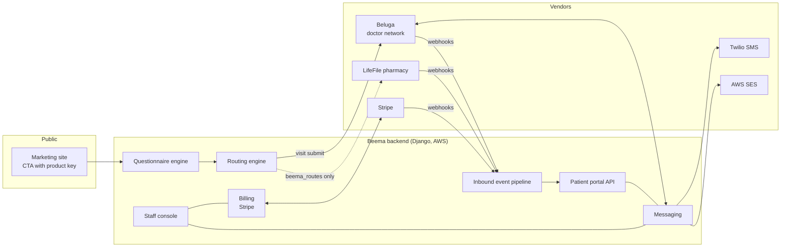

## Flow 2: new patient, questionnaire to prescription

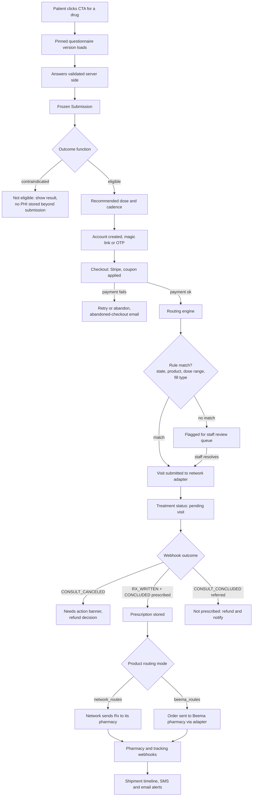

## Flow 3: inbound webhook pipeline (every vendor)

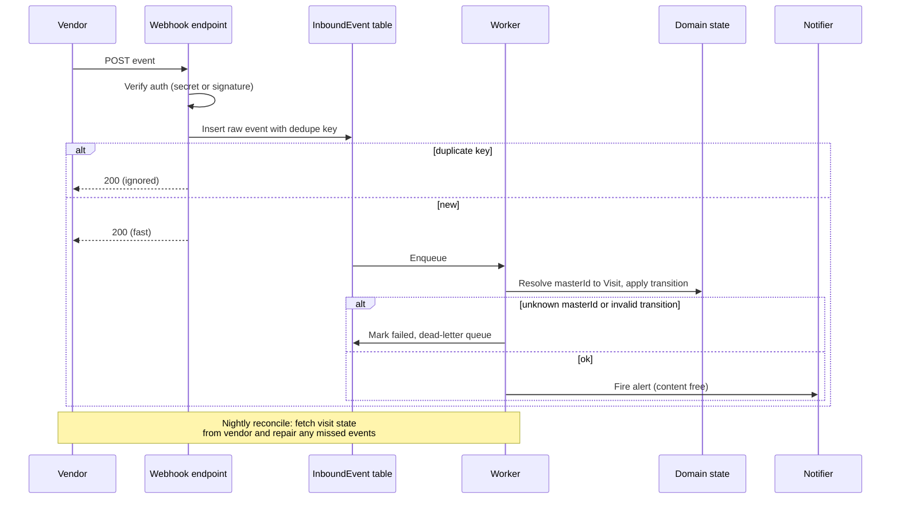

The dedupe key is a hash of vendor, masterId, orderId, event name and payload because Beluga documents no event id.

## Flow 4: messaging (bridged to Beluga)

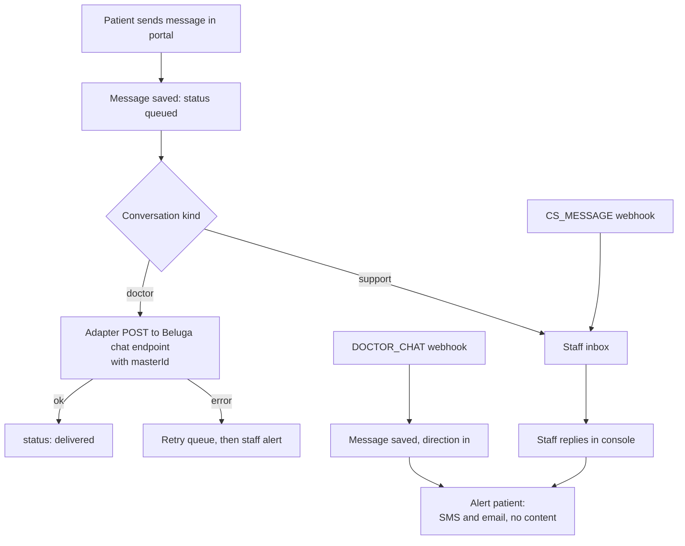

Admin inbox lanes (from the Bask screenshot) fall out of conversation state rather than separate tables:
Active, Awaiting store reply, Awaiting doctor reply, Your inbox, Unassigned, Archived.

## Flow 5: treatment lifecycle (state machine)

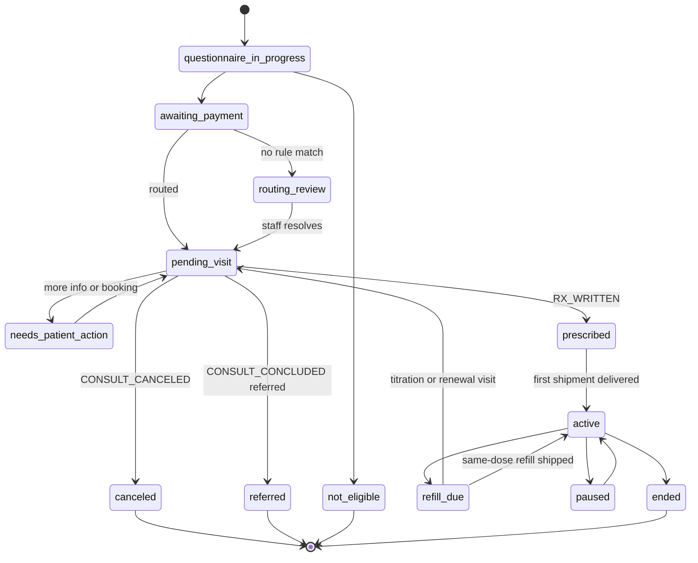

"Pending" and "Active" tabs on the Treatments page map to these states. The portal "Required action" banner is any treatment in `needs_patient_action` or a failed payment.

## Flow 6: subscription, coupon and price resolution

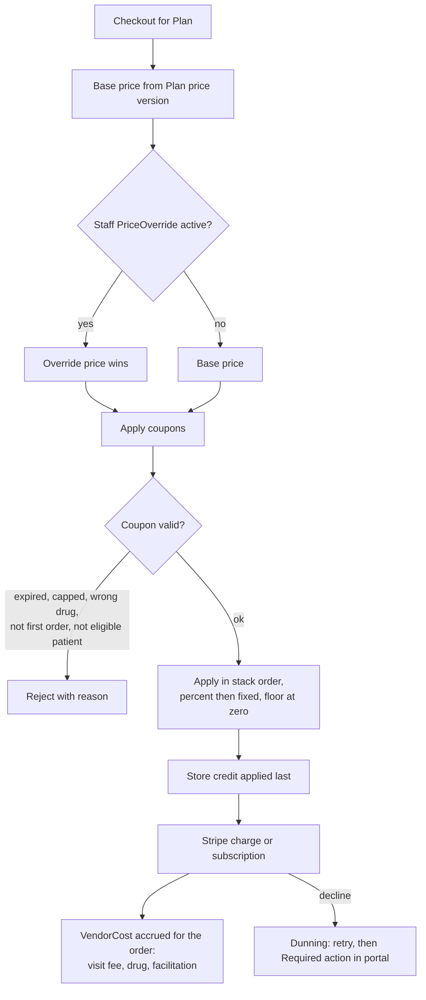

## ERDs (fields trimmed to what drives decisions)

All money fields are integer cents. All PHI tables are audit logged. Every table has `id` (UUID), `created_at`, `updated_at`.

### Identity and access

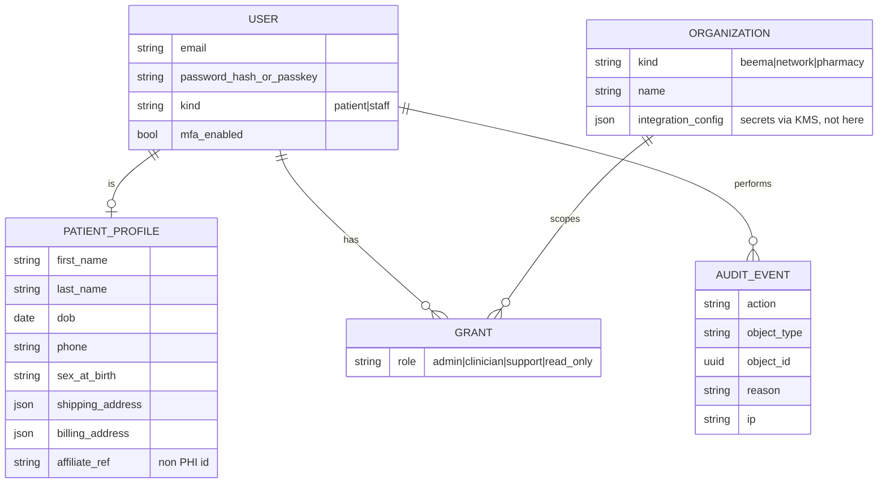

### Catalog and pricing

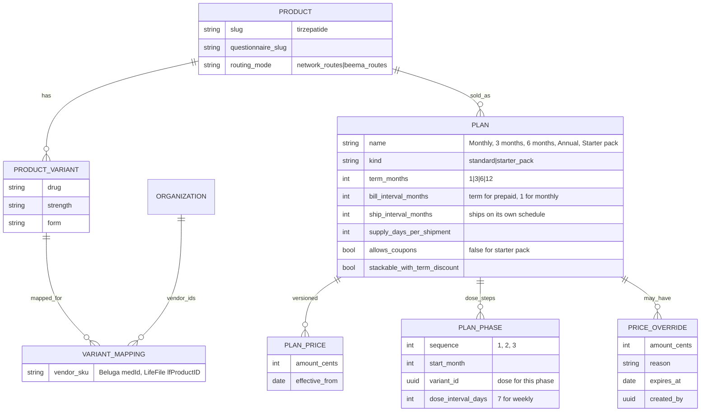

### Questionnaire, routing and clinical flow

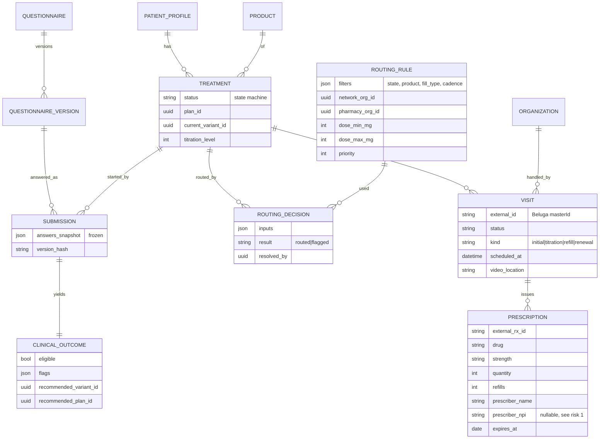

Beluga `masterId` resolution (from the legacy integration): the initial consult and same-dose refills share one `masterId`, titration visits get a new one. So `Visit.external_id` is not unique per treatment, and inbound events resolve masterId to Visit to Treatment.

### Fulfillment, doses and health data

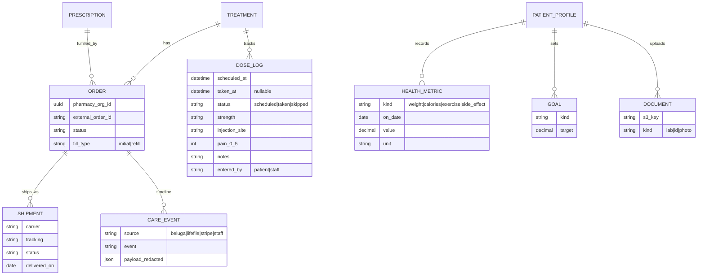

Weight, calories and exercise on the Shots page come from `HEALTH_METRIC` joined by date, not copied onto the dose.

### Billing and promotions

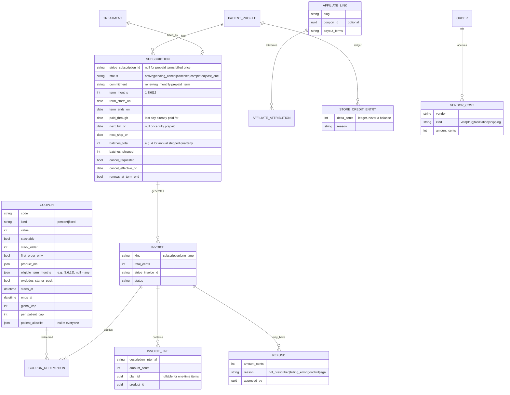

### Messaging, notifications and events

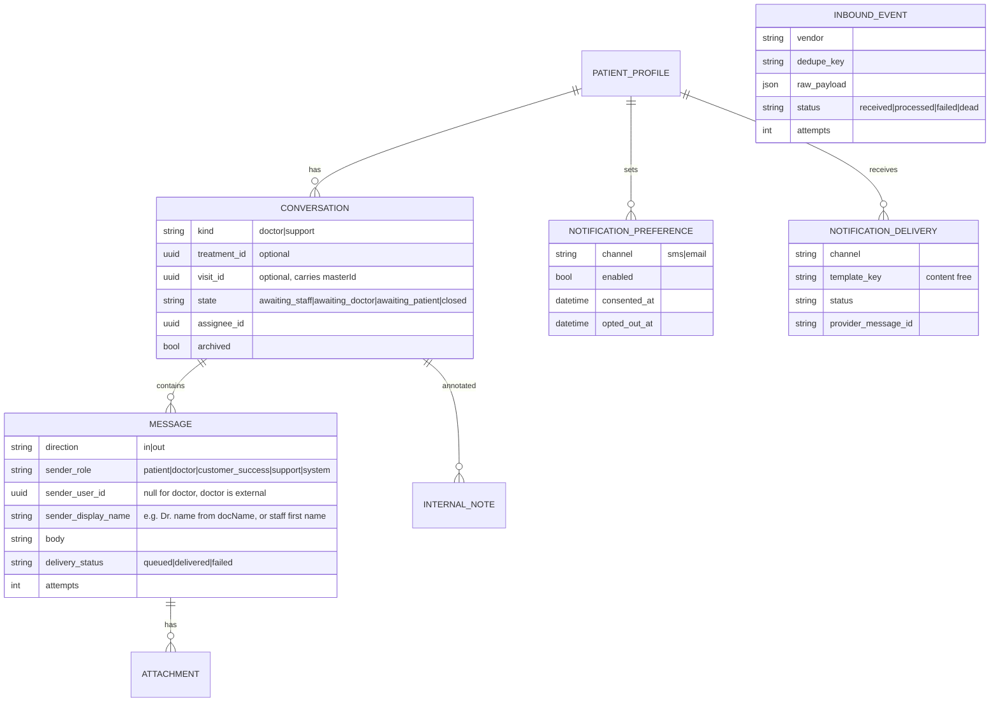

`INBOUND_EVENT` and `OUTBOUND_CALL` have no foreign keys because they must survive unresolved events (an unknown masterId still needs to be stored and replayable).

## Open questions from this draft

1. **Where does the new code live?** Options: (a) new top-level directory (for example `portal/`) next to the legacy `backend/`, port in what we keep, delete legacy when we merge; (b) rewrite inside `backend/`. Recommendation: (a), so legacy stays readable as a reference and nothing half-migrated lingers in the apps list.
2. **One conversation per doctor or one per patient?** The draft has one per kind, and the patient sees a single Chat with doctor and support threads. Bask shows one chat. Confirm.
3. **Cut the medication-levels graph and AI drafting from v0?** Recommended above.
4. **Treatment cards show "Weekly" and "Ships every 6 months".** Confirm the plan fields in `PLAN` (dose, ship and bill intervals) cover every plan you sell. Send me the plan list from the marketing site if any plan breaks the three-interval model.
5. **Account page tabs (Profile, Billing and Shipping, PHI).** Confirm what "PHI" holds. I assume medical history, allergies, medications and ID documents.

## Decisions from review round 2

- Code lives in a new `backend/` (same layout as before). Legacy renamed to `old_backend/`.
- Dosing, shipping and billing are separate fields (see `PLAN`). Confirmed.
- Medication-levels graph and AI drafting are out of v0.
- Dose logging by the patient stays in v0 (the doctor uses it). Confirmed.
- A vendor-cost ledger is in v0, modeled on Bask: the patient pays Beema, vendor charges accrue as `VENDOR_COST`, and profit is the difference. Confirmed.
- Chat shows who is speaking with a role label: Doctor, Customer Success Manager, or Support (`MESSAGE.sender_role`). Doctor messages carry the doctor's name from Beluga's `docName`.
- Stripe product labels are neutral. A simple mapping from internal product to Stripe label.
- Account page "PHI" tab: **download my data** and **request deletion**, nothing else (see Bask screenshot). Deletion is a request that staff review, because HIPAA retention rules can require keeping records. Needs `DATA_REQUEST` (kind: export|deletion, status, reviewed_by, completed_at).

## Pricing facts found in the marketing site (`src/lib/medication-pricing.ts`)

These drove the plan model above. Verify before launch.

| Fact | Schema impact |
|------|---------------|
| Plans are 1, 3, 6, 12 month prepaid terms with a lower effective monthly rate. | `Plan.term_months` and `bill_interval_months` differ from `ship_interval_months`. A 12-month plan is one charge but many shipments. |
| Tirzepatide has a 3-month starter pack ($597) that steps through doses 2.5mg, 5mg, 7.5mg. | `PLAN_PHASE` holds the dose per month. Starter pack has `allows_coupons = false`. |
| Starter pack and multi-month discounts do not stack. | `stackable_with_term_discount` on the plan. |
| Promo code: one-time, once per patient, 3/6/12-month plans only, not 1-month, not starter. | `Coupon.per_patient_cap = 1`, `eligible_term_months = [3,6,12]`, `excludes_starter_pack = true`. |
| Prepaid terms mean refunds and cancellations mid-term need a rule. | Open: refund policy for unused months (Stripe proration or manual). Needs a business decision. |

New open question: **what happens to a prepaid 6 or 12 month patient who is not prescribed, cancels at month 2, or changes drug?** The schema can model any answer, but the refund rule must come from you and your compliance review.

## Billing model: subscriptions and one-time charges

Two kinds of money movement, both on `INVOICE`:

- **Subscription invoices**: the first and renewal charges for a plan.
  - 1 month: renews monthly until the patient cancels.
  - 3, 6 and 12 months: one prepaid charge up front. Shipments are delivered **three months at a time** (3 months = 1 batch, 6 months = 2 batches, 12 months = 4 batches). At term end the plan either renews (if the patient agreed to auto-renew at checkout) or completes.
- **One-time charges**: anything not tied to a term (a single add-on product, a dose-change fee, a reship fee, a manual staff charge). Same coupon engine, same `INVOICE` and `VENDOR_COST` ledger, but no `SUBSCRIPTION` row.

## Cancellation and refund rules (owner's policy, draft)

| Situation | Rule |
|-----------|------|
| Patient is **not prescribed** (visit ends `referred` or the patient is ineligible) | Beema pays the doctor fee. Patient is marked ineligible for that drug. Patient is refunded the charge (assumed, confirm). |
| **1-month plan**, cancels **before the next renewal** | Cancels with no further charge. No refund for the month already paid once the prescription has been sent and is being processed. |
| **3, 6 or 12-month plan** (already paid for all doses) | Cannot cancel for a refund. Shipments continue in 3-month batches until the term is used up. A cancel request only turns off renewal at term end. |
| Prescription **not yet sent** and patient cancels a paid month | Open question: refund or not? The rule above only covers "prescription sent and processing". |

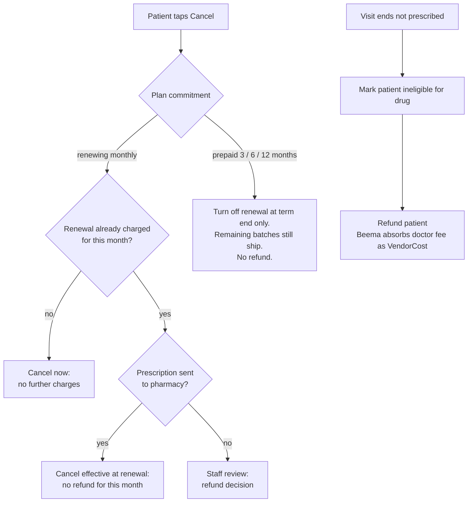

Problems with this policy that need your attention (not blockers for the schema, which can model any rule):

1. **Disclosure.** "No cancellation after prepaying" must be shown clearly at checkout and in the terms, with the patient's explicit acknowledgment stored. Without that, card chargebacks will go against you.
2. **Auto-renewal laws.** Several states (California is the strictest) require clear disclosure of auto-renewal and an easy way to cancel renewal online. The portal needs a one-click "turn off renewal" for every plan, including prepaid ones. Check with your attorney.
3. **Doctor stops treatment mid-term.** If a clinician discontinues the drug for safety (side effect, new contraindication), you cannot ship remaining prepaid batches. Most states and card networks expect a refund of the unshipped portion. The schema has `REFUND.reason = legal` for this. Decide the rule.
4. **Shipments that cannot be filled** (state restriction, pharmacy out of stock): same question for unshipped batches.
5. **Prepaid terms and Beluga's schedule.** Beluga needs a titration or renewal visit at month 3 for GLP-1 (see their doc). If a 6-month patient fails the month-3 check-in, the second batch should not ship. That is the same "unshipped portion" refund question.
